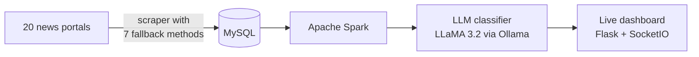
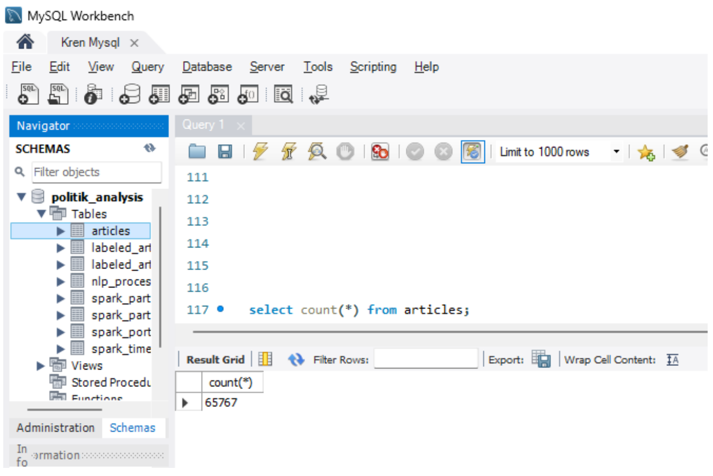
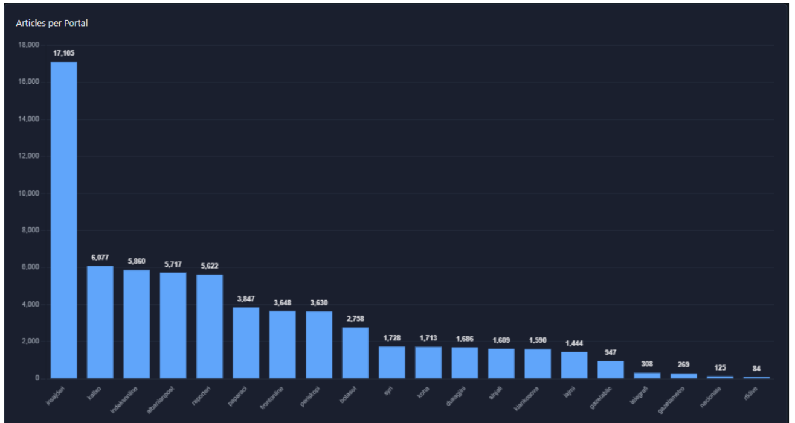
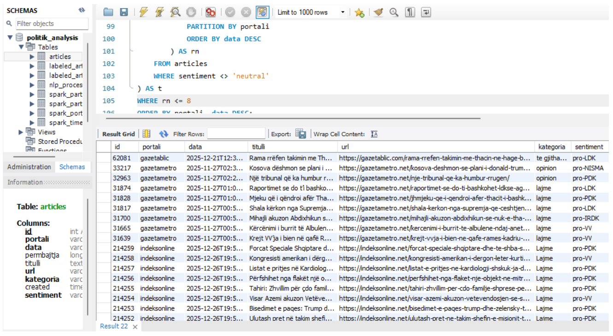
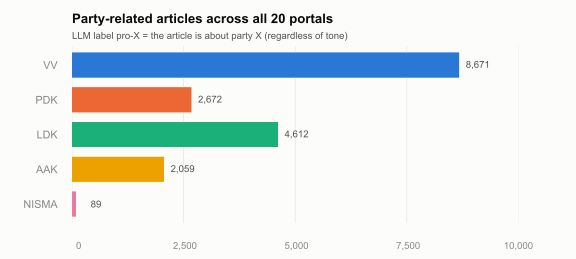
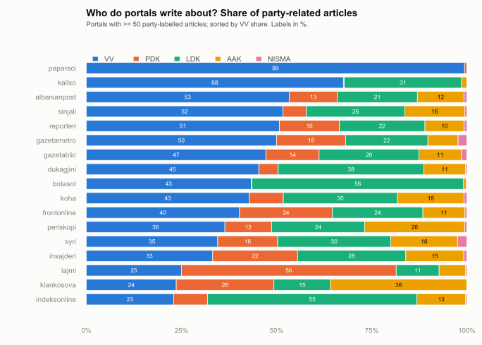

# 📰 Kosovo Media Attention Monitor

**Which political parties do Kosovo's news portals write about, and how much?**
An end-to-end pipeline: web scraping → MySQL → Apache Spark → LLM classification → live dashboard.

`65,767 articles` · `20 portals` · `8 parties` · `real-time`

> This repository is a **project showcase**. Source code and full reports are private.
> Contact: albinajeti20@gmail.com

## Overview

| Stage | What we did |
|---|---|
| **1. Data collection** | Scraped articles hourly. When a site blocked us (Cloudflare, AJAX pages), the scraper fell back from RSS to HTML parsing, then to scraping APIs, then to a headless browser. |
| **2. Storage** | MySQL with a unique key on the article URL, so there are no duplicates. |
| **3. Classification** | An LLM labels each article as `pro-X` (the article is about party X, whatever its tone) or `neutral` (not political). |
| **4. Analytics** | Spark aggregates the portal × party coverage. A web dashboard shows it live. |

## Data collection

**65,767 unique articles** from 20 portals.

## Classification

We tried keyword rules and classic ML (Naive Bayes, BERT) first. Neither handled Albanian text well, so we switched to an **LLM** guided by a list of parties and their elected MPs.

## Results

**VV**, the governing party, gets the most coverage. The bigger story is that **each portal focuses on different parties**:

- **paparaci:** 99% of party coverage is about VV
- **lajmi:** the only portal where PDK leads (56%)
- **botasot / indeksonline:** mostly LDK (55–56%)
- **insajderi** (the largest portal) is the most balanced

*These figures measure attention (how much is written), not sentiment.*

## Next steps
- Validate the LLM labels against a human-labelled sample (precision / recall / F1)
- Classify tone (positive / negative), not only the topic
- Add regional portals

## Team
**Albin Ajeti** · **Aldis Jusufi**. M.Sc. Computer Science, University of Prishtina (2026).
Supervisors: Prof. Dr. Astrit Desku, Ass. MSc. Ilir Kicmari.

© 2026 Albin Ajeti & Aldis Jusufi. All rights reserved. See [LICENSE](LICENSE).
